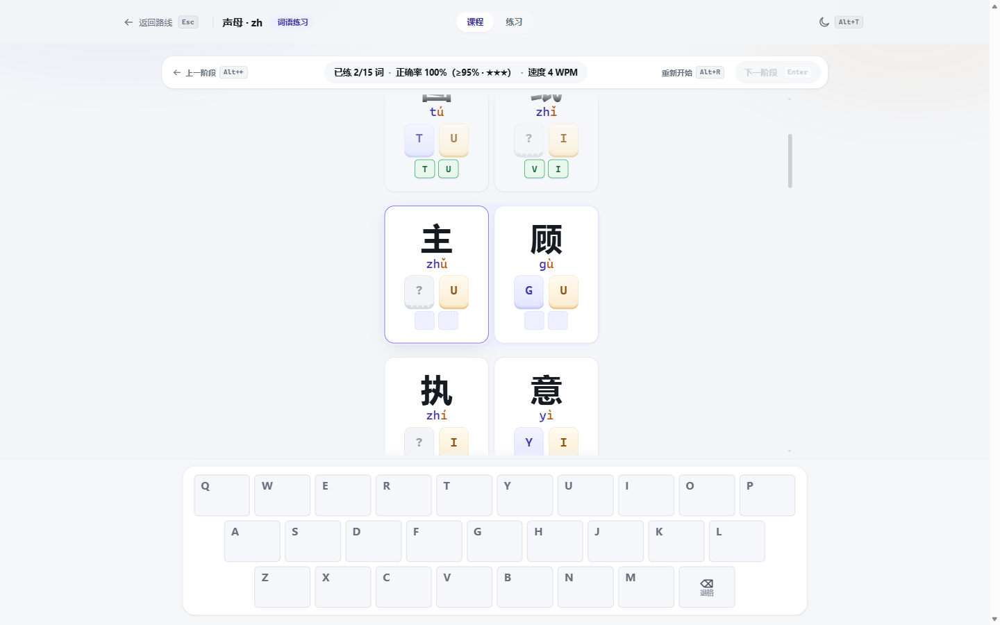

# 双拼 NEXT

> 版本 1.0.0 · 在线体验：https://quxile.github.io/shuangpin-next/

给已经会用全拼、想学会双拼的人。

## 它解决什么问题

双拼要记的键位很多。大多数教程一次把一整张键位表推给你，结果就是：

- 一开始觉得信息量太大，背不下来；
- 勉强背了，却不知道该练什么，练两下就放弃；
- 练习题固定不变，做着做着变成背题；
- 学到后面忘了前面，越学越乱。

双拼 NEXT 把这些问题拆开处理：

- **一次只学一个键位，学过内容自动变成复习**。每一课只引入一个新声母或韵母；每次出的题都只包含已经学过的内容，刚学完就能立刻开始打，不会因为没学过而卡住，也不需要先背完整张表。到了后面的课程，前面学过的键位会自然出现在新练习里，边学新键边复习旧键，不必单独回头“补课”。
- **每一课都随机出题**。同样的知识点，每次练习到的字词都不一样，避免记住某几道题。
- **用日常词汇练真实打字**。练习词汇来自日常常用词：新课每课约 500 词，复习/考核每课约 1000 词，40 课合计约 2.6 万条；另补充三字词与四字成语，既能反复练习而不容易撞题，也更接近日常打字时会用到的表达。
- **先单字，再词语，最后不看提示考核**。新课先用手把手的方式熟悉键位，再用常用词模拟日常打字，最后把提示全部藏起来检验真实水平。
- **打错不会卡死，也不会让你蒙混过去**。打错会保留输入并提醒；可以逐键退回，也可以一次清空重来。一个词错三次，会直接显示答案，保证继续练得下去。
- **每课都有清楚的评分**。按正确率和速度给出 1 到 3 星，1 星就是最低通过标准，知道自己练到什么程度。

## 学习路线

40 课，分 10 章，大约 5 个半小时的正式课程：

1. 认识双拼
2. 声母与零声母
3. a / o 家族
4. 期中检验
5. e / i / u 家族
6. 综合冲刺
7. 通关考核

前半程在教新键位，中间安排复习和速度练习，最后用混合内容检验是否真的能在日常文字中用出来。

## 训练场

课程之外，还有一个可以自己支配的练习场：

- **专项练习**：自己选想练的声母、韵母或零声母音节，只练这些内容，一直练到主动退出。
- **提示隐藏**：可以挑一些键位在练习时隐藏提示，逼自己回忆，而不是照着键帽打。
- **文章练习**：粘贴一篇文章或导入文本文件，按原文顺序逐字练习；标点自动断行，每行最多五个字，练完给出正确率和速度。

## 支持哪些双拼方案

- 小鹤双拼
- 自然码
- 微软双拼
- 搜狗双拼
- 智能 ABC 双拼

## 适合谁

- 会全拼，想学双拼但一直被键位表劝退的人；
- 学过双拼，但长期不用、想重新捡起来的人；
- 想找一个能每天练十分钟、有明确进度和反馈的练习工具的人。

不需要注册账号。学习进度、主题和课程解锁状态都保存在你自己的浏览器里。

## 更多

- [实现说明](docs/ARCHITECTURE.md)
- [词库说明](docs/WORDS.md)

## 来源与许可

- 键位数据参考 [BlueSky-07/Shuang](https://github.com/BlueSky-07/Shuang)（GPL-3.0），仅使用其键位映射作为事实来源。
- 词表和词频来自 [jieba](https://github.com/fxsjy/jieba)（MIT）。
- 拼音转换使用 [pinyin-pro](https://github.com/zh-lx/pinyin-pro)（MIT），仅在生成数据时使用。
