# 双拼 NEXT · 架构与实现说明

本文是项目唯一的设计与运维入口。以**代码、数据文件与自动化校验**为准；与代码冲突时修改本文。

## 1. 项目概览

双拼 NEXT 面向已经会全拼、但没学过双拼的学习者。核心不是重复教拼音，而是把双拼的键位差异拆成可执行的一课一键路径。

```text
40 课 / 10 章 / 5 套完整课程（小鹤、自然码、微软、搜狗、智能ABC）
27 新授课 + 11 复习（期中检验 2 课、综合冲刺 2 课、家族复习 7 课）+ 1 通关考核 ≈ 326 分钟
19 套方案键位数据 / 40 课词池（26,000 条 / 25,255 唯一词）
学习地图 → 入门试打 → 教学页（技巧 + 记忆锚点）→ 单字 → 词语 → 复习/速度 → 通关考核
```

架构原则：

1. **领域层单一权威**：拼音、方案、判题、展示模型、选词、阶段、评分、统计全部在 `packages/core`，Web 不做领域计算。
2. **数据驱动**：与方案相关的键位与 free/learn 划分由 `data/schemes/*.json` 推导（`SchemeEngine.diff()`），代码中不硬编码「小鹤式」键位。
3. **契约 + 校验**：数据文件契约类型在 core，`pnpm verify` 同时跑 typecheck、core 测试、构建和 `scripts/validate-all.mjs`。

## 2. 仓库结构

```text
apps/web/                      Vue 3 + TS + Vite
  src/App.vue                  布局壳（顶栏 / 主题 / 路由出口）
  src/router.ts                路由：/ 与 /practice/:lessonId
  src/pages/                   学习地图、练习页（只做编排，≤220 行）
  src/composables/             useCourseBootstrap / usePractice / useGlobalKeys / useLiveCpm
  src/components/              layout / map / practice / keyboard / intro 与通用组件
  src/stores/                  course（加载与进度持久化）、progress、settings（主题）
  src/lib/                     data（fetch + 缓存）、lessonView（展示视图文案）
  src/styles/                  tokens（语义 token）、base（reset/按钮/公共件）
packages/core/                 纯 TS 领域层（无 Vue/DOM/Node 依赖）
  src/types.ts                 类型与数据文件契约（唯一权威）
  src/pinyin.ts                音节拆分、声调、知识点 ID
  src/scheme.ts                方案引擎
  src/practice.ts              练习展示模型
  src/selector.ts              选词组卷
  src/stages.ts                阶段计划与内容装配
  src/session.ts               会话状态机与统计
  src/scoring.ts               通过标准与星级
  src/atoms.ts                 知识点 ↔ 词匹配谓词
  src/random.ts                确定性 RNG / 洗牌
  tests/                       197 个 core vitest 测试（含数据契约测试，读根 data/）+ 5 个 web 单元测试
data/schemes/                  19 套方案 + index + 判题用例（冻结事实来源）
data/curriculum/               5 套课程（每套 40 课，模板 1.0.0）
data/pools/                    40 课词池 + index
data/words/words.sample.json   10,000 词公共词库（2–5 字）
data/words/anchors.json        记忆锚点索引（syllableChars / finalChars / initialChars，构建期使用）
data/training/bank.json        训练/文章共用字库（5,002 字；词语从公共词库加载）
data/raw/                      jieba dict.txt（不入库，可重新下载）
scripts/lib/                   数据契约工具（路径、原子写、版本 hash）
scripts/curriculum/            build-curriculum.mjs
scripts/word-pipeline/         lib/wordbank.mjs + build.mjs + build-pools.mjs
scripts/curriculum/content.mjs 课程备注与技巧内容库（调研整理 + 方案动态生成）
scripts/sync-data.mjs          data/ → apps/web/public/data/（原子）+ manifest
scripts/validate-all.mjs       全局数据/版本链/同步/规模校验
docs/assets/impl/              界面截图
```

## 3. 快速开始与验证

```bash
pnpm install
pnpm dev       # http://127.0.0.1:5199/ （dev 会先 sync 数据）
pnpm verify    # typecheck + UI 约定检查 + 197 core tests + 5 web tests + build + validate
pnpm validate  # node scripts/validate-all.mjs
```

Node.js ≥ 24：数据脚本直接 import `packages/core/src/*.ts`（Node 原生 TS 类型擦除），因此脚本与运行时共享同一份拼音/方案/课程逻辑。

## 4. 领域模型

### 4.1 音节与知识点

```text
Syllable { text, pinyin, initial, final, tone?, zeroInitial }
Final    = 33 个规范韵母（ü 记 v）
SyllableFinal = Final | 'er'（er 只作为零声母出现）
AtomId   = initial:<声母> | final:<韵母> | zero:<零声母音节>
```

- `zh/ch/sh` 是独立声母；零声母不占声母键，由方案给出完整两键序列；声调只影响显示。
- **j/q/x/y + ü**：全拼写作 u，主键取 `finals[u]`（所有方案都是 U 键，例如「去」= QU）；方案 ü 键（小鹤 V、微软/搜狗 Y）作为判题容错接受。n/l 后的 ü 主键取方案 ü 键（女 NV / NY，略 LT / LY 视方案）。
- `er`、`ue/ve` 等拼写口径由 `pinyin.ts` 统一规范化，非法音节返回 `null`。

### 4.2 方案引擎（scheme.ts）

```text
acceptedSequences(syl)  该音节全部可接受键序列（零声母整段、override 整段、或声母×韵母笛卡尔积；
                        jqxy+u 额外并入 ü 键序列；去重保序）
primarySequence(syl)    展示主键（取 accepted 第一条）
judge(input, syl)       输入是否命中任一可接受序列
keysForAtom(atom)       知识点主键（零声母返回整段单元素）
diff()                  数据驱动的 free/learn 划分（single key && value === atom 即 free）
keyMap()                3 行键盘映射（含方案用到的 ';'）
```

19 套方案的数据驱动 golden cases 在 `data/schemes/engine-cases.json`，由 `engine.test.ts` 全量校验。

Web 键位图（`KeyboardMap`）：所有按键等宽（以最多 10 键/行计算，行内居中，不再按行均分）；第三行末尾固定一个与普通键同尺寸的「退格」键：所有页面都显示且始终可点击/可高亮（练习页会撤销输入；tutorial 页只给按下反馈，入门课试打可撤销输入），不再按页面禁用。

**按下反馈**：任何被程序处理的按键（物理键盘字母、点击键位图、退格键/物理退格，以及 tutorial/锁定/完成态下的字母事件）都会统一由 `showPressed` 在键位图上显示绿色按下态；全遮挡考核（conceal）阶段同样保留按下高亮。

学习地图面板 `course-board` 使用 `overflow: hidden` 裁切内部 Hero 装饰渐变，保证圆角处不出现方形渐变溢出。

### 4.3 课程

`data/curriculum/<scheme>.curriculum.json`：40 课 / 10 章，模板版本 1.0.0。

```text
LessonDef { id, chapterId, kind, title, desc, estimatedMinutes,
            focusAtoms, blockingAtoms, nonBlockingAtoms, prerequisites,
            wordPlan{maxUnfamiliar,lengthRange}, passCriteria?, atomMeta,
            zeroExamples?, tips, stageMinWords?, reviewFamily? }
kind      intro（入门）/ drill（新课）/ review（复习）/ exam（考核）
```

课程结构：10 章，章间按「基础 → a/o → 期中 → e/i/u·ü → 综合 → 通关」推进。

| 章 | 内容 | 关键设计 |
|---|---|---|
| 1 认识双拼 | 入门 | 原理 + 键位图 + 试打（通过记 ★★★） |
| 2 声母与零声母 | zh / ch / sh / 零声母 12 音全表 + 综合 | 翘舌三定；零声母映射一次列全（L2.4）；首课备注提示 jqxy ü/多音字 |
| 3 a 家族 | ai/ao/an/ang → 小复习 → ia/ua、iao、ian、iang/uang、uai、uan → 总复习 | 同键双韵合并（ia/ua、iang/uang） |
| 4 o 家族 | uo、ou、ong/iong → 总复习 | 同键合并（ong/iong） |
| 5 期中检验 | 混合练习 + 速度练习 | 前半程混合检验（混合全显引导、期中速度与综合速度同标准：正确率 ≥85% 且速度 ≥45/60/75 WPM） |
| 6 e 家族 | ei、en、eng → 总复习 | 前后鼻音对比 |
| 7 i 家族 | in、ing、ie、iu → 总复习 | 前后鼻音对比 |
| 8 u 与 ü 家族 | ui、un、ü 组(ü/üe/ve) → 家族复习 | ü 家族三种拼写同课；家族复习收尾 |
| 9 综合冲刺 | 混合练习 + 速度练习 | 全量混合；综合速度与期中速度同为速度专题（正确率 ≥85% 且速度 ≥45/60/75 WPM） |
| 10 通关考核 | 通关 · 最终考核 | 与入门章呼应；全遮挡 + 限时 |

**统一命名法**：

- 章标题 = `<主题短语>`（2–6 字），章 order 1..10、地图显示 01–10；
- 课标题 = `<类别> · <内容>`，类别固定 9 种：`入门 / 声母 / 韵母 / 同键 / 零声母 / 复习 / 期中 / 综合 / 通关`；并列内容用 ` / `；
- 课 id = `L<章序号>.<课序号>`，章内连续；
- `desc`：新授课「新键：…」、规则课「规则：…」、复习「范围：…」、检验类「检验：…」；
- 以上规则由生成器校验 + core 数据契约测试共同强制。

- 只有 `initial/final` 阻塞选词；`zero` 不阻塞；`prerequisites` 累积此前所有 focus 原子；
- **复习范围程序化生成**：累计复习课的 focus 直接取 `prerequisites`（学习顺序），不再手写知识点子集；教学页范围按学习顺序展示（不按类型重排）；
- **同键双韵**：`ia/ua`、`iang/uang`、`ong/iong`、`ue/ve` 在 5 套方案中均共用键位，因此各并成一课（校验器强制「多新原子必须共用键位」或同属 ü 家族）；
- **课程范围只包含具体键位知识点**（initial / final / zero，无规则类原子）；零声母 12 个音节在 L2.4 一次性全表教授（focus + 12 张示例 + 完整映射清单）；`j/q/x/y` 遇 ü 与多音字不进入范围，只在第一课（L2.1 声母 · zh）的备注里合并提示一次；
- 零声母示例 = 本课 focus 的 zero 原子（L2.4 一次展示 12 张全表，家族复习本家族子集，综合课 12 张）；
- **显示标签唯一规则**：零声母知识点一律显示为「零 <音节>」（如「零 ai」），由 core `atomDisplayLabel` 唯一实现并测试；所有课程、章节、卡片、范围标签一致，避免与同音韵母混淆；
- 每个方案的 learn 原子必须被某课教授（含微软/搜狗的 `final:v`，并入 L8.3「韵母 · ü / üe / ve」；ü 家族允许同课多键）；
- `stageMinWords`：各阶段最低完成**词数**（逐字练习 1 字 = 1 词，见 §5.3）；`passCriteria`：`accuracy`、可选 `mode`（accuracy / speed / accuracy-speed）、`minCpm`、`starCpm`；入门课无门槛、完成即 ★★★；
- 每课最后一场都是**全遮挡考核**（exam 阶段）：提示档位由阶段唯一决定（single 1 / word 2 / exam 3），数据不再有 hintTier 字段；
- **展示规则统一由 kind + 数据决定**：记忆锚点只在新课显示（零声母全表课为程序生成的汇总行），review/exam 永不显示；零声母标签统一「零 x」前缀。

### 4.4 词池

`data/pools/<lessonId>.json`：`{ lessonId, words, chars, examples }`。5 套课程共用（以 xiaohe 课程作为词池结构的规范来源）。

- `words`：目标词；`chars`：单字池（非零声母课不掺零声母字）；`examples`：教学示例；
- `WordEntry` 的 `freqRank` 是**全量词表全局排名**，`tone ∈ 1..5`（轻声记 5），保留 `polyphone` 标记。

### 4.5 数据版本链

每次数据重建都写入内容 hash，由生成器与校验器共用同一算法：

```text
dataVersion = "curriculum-" + sha256(JSON.stringify({ chapters, lessons })).slice(0,12)
dataVersion = "pools-"      + sha256(concatenate(sorted(fileName + fileContent))).slice(0,12)
dataVersion = "words-"      + sha256(dictSha | pinyin-pro 版本 | 过滤参数 | 词条内容).slice(0,12)
```

- `data/pools/index.json` 的 `sources = { curriculum: <xiaohe 课程版本>, dict: <词典 sha256 前 12 位> }`；
- `manifest.json` 记录 `versions{curriculum,pools,words}`、`defaultScheme`、`courses` 与文件清单；
- 当前版本：`curriculum-2171c31e67d3`（xiaohe）、`pools-24450f68e49a`、`words-ea1e2eb0f56e`、`training-cb1e4cc25756`；音节补丁：`data/words/syllable-patches.json`，词库策略：`data/words/word-policy.json`，训练库：`data/training/bank.json`。

### 4.6 手写逻辑审计

原则：可推导的键位、示例与校验一律程序生成；只有「课程内容」与「事实数据」允许手写。

- 示例音节与代表字由 builder 从 `words.sample.json` 自动生成，不保留静态示例表；
- 词典未收录音节（zhei、eng 等）放在 `data/words/syllable-patches.json`，不在代码内特判；
- 教学示例的音节枚举由 `scripts/lib/pool-examples.mjs` 统一提供，build-pools 与 validate-all 共用；
- 词性过滤、词池规模、质量与示例阈值、intro 试打词等口径集中在 `data/words/word-policy.json`；
- 复习/考核池按全局使用计数优先低使用词；单字池按公共 10,000 词上下文统计多音风险；
- validate-all 按数据特征（focus 数量、家族、review 条件等）定位校验对象，不依赖 lesson id 常量。

保留为「内容 / 契约 / 事实」：课程模板（TEMPLATE/CHAPTERS/FAMILIES）、教学文案库、`stageMinWords` / `passCriteria` 数值、词库阈值、拼音常量与方案键位 JSON。

## 5. 学习流程

### 5.1 学习地图

- 顶部全局顶栏提供**板块导航**：「课程」（学习路线与单课练习，当前板块）与「练习」（专项/文章练习）；课程板块在单课练习页保持激活；练习页的**阶段名**（单字练习 / 全遮挡练习 / 本课教学等）显示在全局顶栏的课程名之后；
- **地图滚动位置按方案记忆**（sessionStorage）：点击课程进入详情/练习、切换板块或浏览器前进后退后返回地图时恢复原位置；恢复时临时关闭全局平滑滚动，并在内容渲染后直接落到目标位置，避免先显示顶部再滚动；首次进入仍置顶。
- Hero 与章节共用面板；进度 = 已通过课程 / 40；
- 课程解锁：前置课程 passed 后解锁；「解锁全部课程」可解除全部顺序限制并持久化，按钮随状态变为「恢复锁定」（可恢复按进度解锁）；已通过课程可重练；
- 切换双拼方案（5 套）；评分规则入口只在教学页（主页面不再提供）；「清除学习进度」只清当前方案、不影响解锁标记。

### 5.2 入门课（intro）

独立 5 步组件：全拼成本 → 双拼原理 → 键位图 → 与全拼重合 → 试打「双拼」。

- 所有键位/改造声母/零声母示例都由当前方案引擎动态生成，不写死某套方案；
- 试打复用 core 会话状态机（整字判题、错误保留并锁定、退格撤销、空格/Enter 清空、三次揭示）；
- 完成后写入通过进度并统一记 ★★★；键位图固定在页面最下方（内容区独立滚动）。

### 5.3 练习阶段（三阶段 + 无限练习）

阶段由 `lessonStages(lesson)` 给出；非 intro 课程先走教学页，再进入练习阶段。**单位统一为词**（逐字练习时 1 个字 = 1 个词），**每一课最后一场都是全遮挡考核**。

| 课程类型 | 阶段（提示档位） | 最低词数 |
|---|---|---|
| drill（新课） | 单字练习（1，全显）→ 词语练习（2，半遮挡）→ **全遮挡考核**（3） | 15 → 15 → 25 |
| review（复习） | **全遮挡练习**（3） | 50 |
| exam（通关） | **通关考核**（3） | 100 |
| intro | 独立入门组件 | — |

提示档位由阶段唯一决定：`hintTierFor(stage)` = single 1 / word 2 / exam 3；数据不再有 `hintTier` 覆盖字段。

**目标行 → 继续练习**：进入阶段时只生成目标词数（`stageMinWords`）的卡片，列表不自动增长。完成最后一张卡后，列表末尾出现操作行：

- 已达标：`Enter` 进入下一阶段（最后阶段为完成本课），或 `Alt+Enter` 继续练习；
- 未达标（全遮挡考核）：只提示未达标原因，按 `Alt+Enter` 继续练习，达标后 Enter 才可用。

选择继续练习后才进入**无限模式**：批次用完后由 `applyKey(state, key, at, { extendWords })` 自动追加下一批（单字重洗、词语/考核换 seed 重新组卷），卡片列表持续增长；用户想练多久练多久。

**自动滚动**：当前行变化（完成一行、切换阶段、追加批次）时把活动行滚到视口垂直居中；完成提示行出现时滚到提示行可见——只按行变化触发，避免逐字抖动。

**阶段门槛 `stageGate(lesson, stage, metrics)`**：

- 单字 / 半遮挡词阶段：完成词数达到 `stageMinWords` 即可继续（只作最低量要求，不卡正确率）；
- 全遮挡考核阶段：除词数门槛外，还必须达到本课 `passCriteria`（正确率 ≥85%；复习课附加最低速度 45 WPM，速度课/通关课再加各自的速度门槛）。达标后可自由选择继续练习或完成本课。
- 顶层操作条中央是练习数据胶囊：`已练 X/Y 词 · 正确率 N%（当前档位）· 速度 N（当前档位 WPM）`；未产生任何输入时三段都显示 `--`，不会先显示 0。档位由 core `accuracyTiers` / `speedTiers` 与评分配置同源计算：每档同时显示对应星级：`<85% · 0★`、`85–90% · ★`、`90–95% · ★★`、`≥95% · ★★★`。速度课/准确率+速度课按速度星级门槛四档；只有速度底线的课显示 `<45 WPM · 0★` / `≥45 WPM · ★` 两档；无速度要求则只显示原始 WPM，不给星级。左右分别为上一阶段、重新开始与主操作；阶段名不再重复在操作条中。

**阶段切换与按钮语义**：

- 每阶段保留独立的 `SessionState`；来回切换用 `resumeSession` 恢复（暂停时间不计入速度），已达标阶段保持解锁（粘滞），返回上一阶段不需要重新完成目标；
- 工具栏始终显示「上一阶段」：新课 考核→词语→单字→课程详情；复习/通关 全遮挡→课程详情；
- 主按钮文案只由阶段位置决定：非最后阶段始终「下一阶段」，最后阶段始终「完成本课」；只有 enabled 状态随门槛变化；
- 移除工具栏「返回路线」（顶栏已有）；「重新开始」可重置当前阶段会话。

- 单字阶段从 `pool.chars` 挑「本课 focus + 已学/free」的字，概率均衡抽样；词语/考核由 `selectWords` 组卷，允许 2–5 字词（含零声母成语与五字词）；
- 教学页示例由课程数据全量生成：**按 focus 原子学习顺序，枚举所有包含该声母/韵母的音节，跨知识点去重，每个音节一张卡（高频代表字）**，不设数量上限（综合课约 400 张）；示例卡比练习卡更紧凑（宽高比 340/392，上下内边距 7px 对称）；
- 教学页同时展示 `lesson.tips`（本课技巧）与 `atomMeta.anchors/mnemonic`（记忆锚点），见 §8；
- 课程详情页采用全高布局：左侧卡片不显示「这节课学什么」标题（kicker 后直接进入范围），课程范围容器撑满剩余高度（**唯一可滚动区域**：标签多时仅在容器内部滚动）；记忆锚点（键位技巧）与「本课技巧」同等地位，固定在卡片底部（开始按钮之上），不随范围滚动；
- 右侧栏拆成**两张独立卡片**：**上**示例卡（胶囊标题「示例」+ 张数，列表内部滚动）；**下**评分规则卡（胶囊标题 + `describePassCriteria` 规则行，不再显示「答案揭示」说明）；课程信息、示例、评分规则三处顶部胶囊使用同一个 `side-pill` 样式，且三张卡片顶部内边距统一为紧凑的 12px——胶囊距卡片上边框的间距完全一致（1440 与 390 实测均为 16px），不再有悬浮「? 评分规则」胶囊；页面整体不滚动。
- **记忆锚点（键位技巧）的唯一展示规则**：只在新课（drill）出现——有改造键位时逐键展示记忆法与高频字；零声母全表新课用一条程序生成的「零声母」汇总行（12 音映射）。复习/考核课一律不显示。不按 focus 数量等条件做启发式判断。

### 5.4 输入与错误

- 每字独立记录输入、错误次数、是否揭示答案；输入合法键 = 小写字母或 `;`；
- 整字判题（多解容错）：判错后**保留红色错误输入并锁定**，继续按字母无反应（不增加错误数）；退格逐键撤销并解除错误状态；空格或 Enter 一次清空当前字输入（Enter 清空优先于主按钮）；
- 同一个字第 3 次错误后揭示目标键；退格只回退当前字已输入的最后一个键；
- 阶段统计由 `sessionMetrics` 给出：`accuracy = 正确字数 / (正确字数 + 错误次数)`，`cpm = 正确字数 / 用时`。

### 5.5 训练场（/training）

顶栏「练习」导航进入，不写课程进度与星级，用于自由巩固；页面标题为「训练场」（正文不使用「板块」措辞）。

- **方案选择**：页面内可直接切换双拼方案（全局生效）。
- **专项练习**：字 / 词二选一；「出现」卡头显示**当前学习进度**（已通过课程数/40）并可一键选中已学完课程覆盖的声母、韵母、零声母；「出现」栏的声母、韵母分组内各有一个置顶的「全拼沿用」小胶囊（只显示四个字，不展开内部键位）；胶囊算作该组的一个可选项，组全选/全清、隐藏组全选都把它一并处理：按**当前方案**自动计算与全拼拼写一致的 free atoms（不手写固定集合），切换方案时自动重算；这些键位默认开启，可通过胶囊单独取消。以 xiaohe 为例，声母胶囊包含 20 个公共声母（除 zh/ch/sh）和 ai/an/ao/ei/en/er/ou 七个公共零声母，韵母胶囊包含 a/o/e/i/u/v 六个公共韵母；切到微软/搜狗时 v 不再公共，胶囊所代表的集合自动变化。声母组其余仅显示 zh/ch/sh，韵母组其余只显示方案专属映射，**零声母按音节逐项展开**（`零 a`、`零 ai`…共 12 项，含 `零 er`；零声母是独立选择集，不受普通韵母勾选限制）；支持全选勾选框并预览可用条目；过滤规则由 core `filterTrainingEntries` 统一实现（非零音节命中声母×韵母，零声母命中 `zeroFinals`）；训练范围、隐藏选择、字/词模式与 tab 按方案保存在 localStorage（`trainingConfig.ts`），刷新/切换方案后恢复；开始后直接进入**无尽练习**（无目标行/完成提示，批次自动追加），直到退出；实时显示已练字/词数、正确率、速度。
- **「隐藏」双选栏**：专项中隐藏候选**只显示「出现」已选中的声母/韵母/零声母音节**（出现范围变化自动收缩）；文章练习无出现筛选，隐藏候选为方案全部声母/韵母/零声母；与出现栏一致在声母/韵母组内提供置顶的「全拼沿用」小胶囊；胶囊计入组内项目数，隐藏组全选同样包含胶囊；公共 free atoms 默认开启，也不混入普通 chips。被隐藏的音节在字卡与键位图上不显示映射提示，但键位仍需按对、判题不变，同一个字第 3 次错误仍会揭示答案。
- **页面布局**：训练场桌面不整页滚动——顶部（标题/方案/tabs/字词切换）固定，中间两栏撑满剩余高度、等宽等高且各自卡内滚动，底部为固定 72px 底栏（左侧两行信息、右侧开始按钮，不随卡内滚动移动）；不再显示「开始后为无尽练习…」提示。
- **统一卡片**：出现、隐藏、文章隐藏三张选择卡共用同一 `SetupCard + SetupGroup` 模板（固定卡头：色块 pill + 副标题；正文：声母/韵母分组 = 名称 + 计数 + 全选勾选框 + 「全拼沿用」小胶囊 + 方案专属 chips），只替换文案与选择逻辑；文章输入卡也套用同一外框与内部滚动。
- **会话顶栏**：与课程练习、入门课共用 `SessionBar`（48px 卡片；左侧操作、中间数据胶囊、右侧主操作）。训练场胶囊显示已练字/词、正确率、隐藏项与速度（WPM）；隐藏项悬浮可查看具体音节。
- **文章输入卡**：卡头为「输入 / 导入」分段滑动开关——输入模式文本框撑满卡内正文；导入模式显示可点击/拖拽的 .txt 上传区并撑满（UTF-8），不再有独立的「导入 .txt」按钮；两种模式共用文章内容与解析结果。
- **文章练习**：粘贴文本或导入 `.txt`；core `parseArticleText` 只保留汉字，**任何非汉字（标点、引号、括号、字母、数字、空白、换行）都不显示并作为断行**，连续分隔合并，每行最多 5 个汉字（短行保留）；多音字按训练库常用读音处理、不做上下文消歧，字库外汉字会跳过并在开始前提示；按顺序逐字练习，练完显示字数/正确率/速度汇总。
- 训练数据：`data/training/bank.json`（chars 5002，仅字库，约 0.8MB；词语从公共词库加载）与 `data/words/words.sample.json`（10,000 词）；输入/错误锁定/退格/空格清空/按下高亮与课程练习共用同一套逻辑。
- 评分面板：右栏「评分规则」只展示 ★/★★/★★★ 三档。

## 6. 星级规则（scoring.ts 单一实现）

教学页右栏「评分规则」与判定同源（`describePassCriteria` / `evaluateLesson`）；**只展示 1–3 星，1★ 即最低限度的通过，不再单列「通过」等级**；规则行使用固定宽度的星标列，保证描述文字左对齐。

| 课程 | ★ | ★★ | ★★★ |
|---|---|---|---|
| 入门 | 完成试打 | 同 ★ | 完成试打即记 ★★★ |
| 新课 drill（25 词全遮挡考核） | 正确率 ≥85% | 正确率 ≥90% | 正确率 ≥95% 且未揭示答案 |
| 复习 review（50 词全遮挡；家族/混合） | 正确率 ≥85% 且速度 ≥45 WPM | 正确率 ≥90% 且速度 ≥45 WPM | 正确率 ≥95%、速度 ≥45 WPM 且未揭示答案 |
| 期中/综合速度（50 词） | 正确率 ≥85% 且 ≥45 WPM | 正确率 ≥85% 且 ≥60 WPM | 正确率 ≥85% 且 ≥75 WPM |
| 通关考核（100 词全遮挡） | 正确率 ≥85% 且 ≥30 WPM | 正确率 ≥90% 且 ≥40 WPM | 正确率 ≥95%、≥50 WPM 且未揭示答案 |

- 全遮挡阶段：1★ 门槛未达标时「完成本课」不可点；达标后可继续无限练习或完成；
- 已通过课程重练：仍记录 attempts / bestAccuracy，星级取历史最优；
- 速度实时显示于工具栏。

## 7. 概率均衡选词（selector.ts + balancedSampling.ts）

- free 原子始终视为已学；`newFocus = blockingAtoms - prerequisites`；
- 候选分层：S（未知 ⊆ newFocus）、A（额外 ≤ maxUnfamiliar 个预习原子）、B（无未知原子）；
- 只有 newFocus 为空（复习/考核/规则课）时，候选必须命中至少 1 个 focus 原子；
- 零声母逐音节门禁：候选词中的每个零声母音节必须在本课 focus 中或已学，否则排除；j/q/x/y 遇 ü、多音字不参与选词，仅作首课备注提示；
- **目标音计数**：每个候选记录 `a_w(f)` = 该词中目标音 f 的出现次数；同一个词含 3 次 sh 就计 3；
- **基础权重**：`q_w × Σ_f a_w(f)`，目标音出现次数越多，候选越容易被抽中；
- **音级校准**：用 θ_f 调整权重 `q_w × Σ a_w(f) × exp(Σ θ_f a_w(f))`，迭代使各 focus 的期望出现次数相等；
- **无放回系统抽样**：由权重求包含概率 π（Σπ=N），用不等概率系统抽样固定选出 N 个不重复词；期望由 π 保证，实际单轮允许波动；
- **以字代词**：某 focus 在词池中的可用候选太少时，从 `pool.chars` 加入单字候选，直接参与同一套概率抽样；
- 数据上确实无法达到相等期望的 focus（候选容量不足）退出均衡集合，但实际仍可被抽到；不伪造不存在的词；
- 同 seed 完全可复现；应用每次进入阶段使用新 seed。

## 8. 教学备注与记忆锚点

每节课都带 1–4 条 `lesson.tips`（技巧备注）；声母/韵母知识点带 `atomMeta.anchors`（高频字锚点）与 `atomMeta.mnemonic`（一句话记忆法）。教学页展示「本课技巧」与锚点行（锚点区块不设可见标题，仅保留屏幕阅读器标签）；零声母 12 音不生成锚点，直接以 L2.4 的映射标签 + 示例 + 完整清单呈现。

### 8.1 内容来源

- 调研整理（跨方案通用方法）：脚手架式记忆与「先准确后速度」（[shuangpin.xyz 四步学习路线](https://shuangpin.xyz/blog/start-shuangpin/)）、字组结合与 5-5 原则/漏洞表（[oroc 七日上手双拼](https://blog.oroc.top/post/double-pinyin-guide/)）、口诀与规律（[一文搞懂小鹤双拼](https://www.cnblogs.com/PeterJXL/p/18539136)）、高频字与盲打训练（[键位记忆方法](https://www.php.cn/faq/3096414.html)、[提速技巧](https://www.php.cn/faq/3096337.html)）、前后鼻音对比（[普通话测试站](https://putonghua.szu.edu.cn/info/1014/2862.htm)）；
- 文本内容库：`scripts/curriculum/content.mjs`（`buildLessonTips` 按课程类型、focus 原子、方案键位、家族/规则动态组装）；
- 方案相关部分（键位、同键伙伴、零声母 o+ 式/字母式）全部由 `data/schemes/*.json` 推导，不写死某套方案。

### 8.2 记忆锚点生成（程序兜底，数据驱动）

`data/words/anchors.json` 由 `scripts/word-pipeline/build.mjs` 生成（构建期内容索引，不进运行时）：

```text
syllableChars  每个音节按字频取常用字（先用公共 10,000 词词表的常用字集合过滤繁体/生僻字，每音节前 8）
finalChars / initialChars  按韵母/声母归组的常用字
```

`build-curriculum.mjs` 按「按键 + 音」组合生成：

| 知识点 | 生成规则 | 示例（小鹤） |
|---|---|---|
| 韵母 | `K + 韵母 = 音节`，取该音节高频字；非法音节回退为该韵母常用字 | `ai→D` → `D + AI = DAI` → 带 呆 待 代 戴 |
| 声母 | 找同键位韵母 P，`声母 + P = 音节`，取高频字 | `zh`（V 键，含 ui）→ `ZH + UI = ZHUI` → 追 |

无法组合出合法音节或没有数据时跳过（不强求）。

## 9. 进度与本地设置

- 键：`shuangpin-next:progress:<schemeId>`；值：每课 `{passed, stars, bestAccuracy, attempts, updatedAt}`；
- 主题：`shuangpin-next:theme`；解锁全部课程：`shuangpin-next:unlock-all`（解锁写入、恢复锁定移除）；读写均有形状校验与容错；
- 清除进度只影响当前方案；解锁标记不受清除进度影响；尚未接入账号/数据库/SRS。

## 10. 数据管线

```bash
pnpm data:words        # jieba dict → data/words/words.sample.json（8000 词）+ anchors.json（记忆锚点）
pnpm data:curriculum   # 方案数据 + 课程模板 → data/curriculum/*.json
pnpm data:pools        # 词表 + 课程 → data/pools/*.json
pnpm data:sync         # 原子同步到 apps/web/public/data/ + manifest
pnpm validate          # 版本链/同步/规模/文档入口校验
```

- `scripts/word-pipeline/lib/wordbank.mjs` 是唯一词条构建逻辑（jieba 解析 + core `splitPinyin` + tone 0→5 + polyphone + 全局 freqRank）；
- `scripts/curriculum/content.mjs` 是课程备注/技巧的唯一内容库；`anchors.json` 提供程序化记忆锚点；
- `build-curriculum.mjs` 用 `engine.diff()` 计算 free/learn，并校验 learn 原子全覆盖；
- `sync-data.mjs` 先写临时目录再整体替换；Windows 目录被占用时退化为逐文件原子写；
- `validate-all.mjs` 重算三条版本链、learn 覆盖、命名法、rule 范围、tone/freqRank、public 逐字节一致、manifest、规模与文档入口，失败退出码 1。
- `scripts/word-pipeline/audit-words.mjs` 输出词库/词池统计；口径集中在 `data/words/word-policy.json`（词性过滤/词池规模/质量与示例阈值/intro 试打词），示例枚举由 `scripts/lib/pool-examples.mjs` 在 build-pools 与 validate-all 间共享；词库问题与改进见 [WORDS.md](WORDS.md)。
- `scripts/training/build-training-bank.mjs` 生成训练/文章共用字库 `data/training/bank.json`（5,002 字）；词语统一来自公共词库 `words.sample.json`（10,000 词），不再重复存储。
- 当前课程模板 1.0.0；词池 40 课 / 26,000 条 / 25,255 个唯一词；公共词库 10,000 词。

## 11. 测试

`pnpm test`（`packages/core` 197 个 + `apps/web` 5 个）：

```text
engine.test.ts        19 套方案 golden cases + 主键/判题/keyMap/diff
pinyin.test.ts        常量、规范化、拆分（含 er 与 jqxy+u）、知识点 ID
practice.test.ts      真实词库/词池的键帽、零声母、多方案（小鹤/微软）、缺数据显式报错
selector.test.ts      drill/review/exam/零声母课、maxUnfamiliar、seed 可复现、final:v 门控
session.test.ts       逐字推进、错误反馈、退格、统计与速度、无限延伸、暂停恢复、结束态
training.test.ts      训练范围过滤（声母/韵母/零声母）与文章解析（汉字、断行、每行≤5字）
scoring.test.ts       普通/速度/考核/入门星级与评分规则文案（1–3 星）
stages.test.ts        阶段计划（三阶段词口径）、提示档位、阶段门槛（stageGate）、单字/词语/全量示例装配
data-contract.test.ts data/** 契约、版本链、tone/er/freqRank、learn 覆盖、同键配对规则、
                      命名法/id 结构、复习范围程序化（L2.5）、stageMinWords/无 hintTier、
                      示例全量与学习顺序、tips/anchors/mnemonic、public 同步
apps/web/tests/trainingConfig.test.ts 训练配置持久化：按方案读写、非法字段过滤、
                      损坏 JSON 与存储异常降级
apps/web/tests/trainingGroups.test.ts 组内胶囊计数、全选/部分选中、只选胶囊的隐藏组
```

Web 端领域规则下沉 core；训练配置持久化等 Web 纯逻辑补独立单测；`scripts/check-ui-conventions.mjs` 额外做上下文色调/重复 chip 样式的静态检查。

## 12. 界面快照

> 截图为手工导出的静态文件，不是自动生成/自动刷新；`validate-all` 只校验文档引用文件存在。
> 修改训练场/地图 UI 后必须人工重新核对并替换截图。

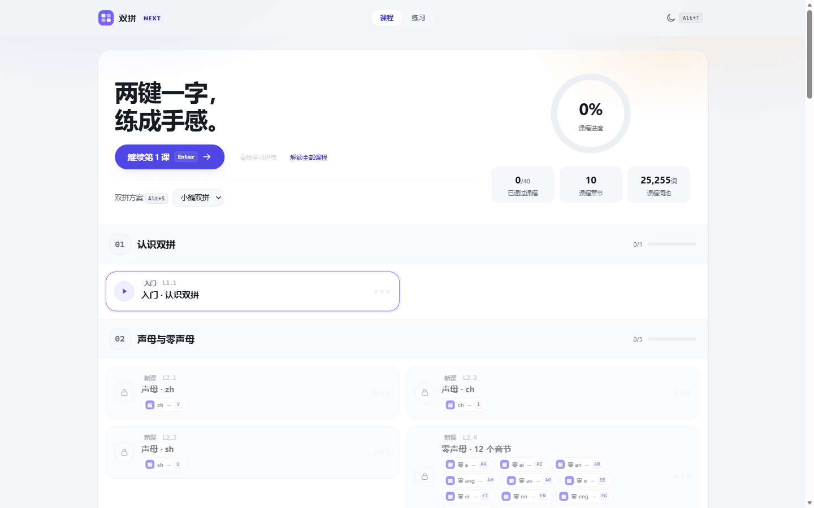

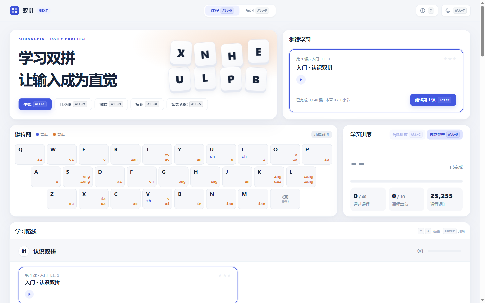

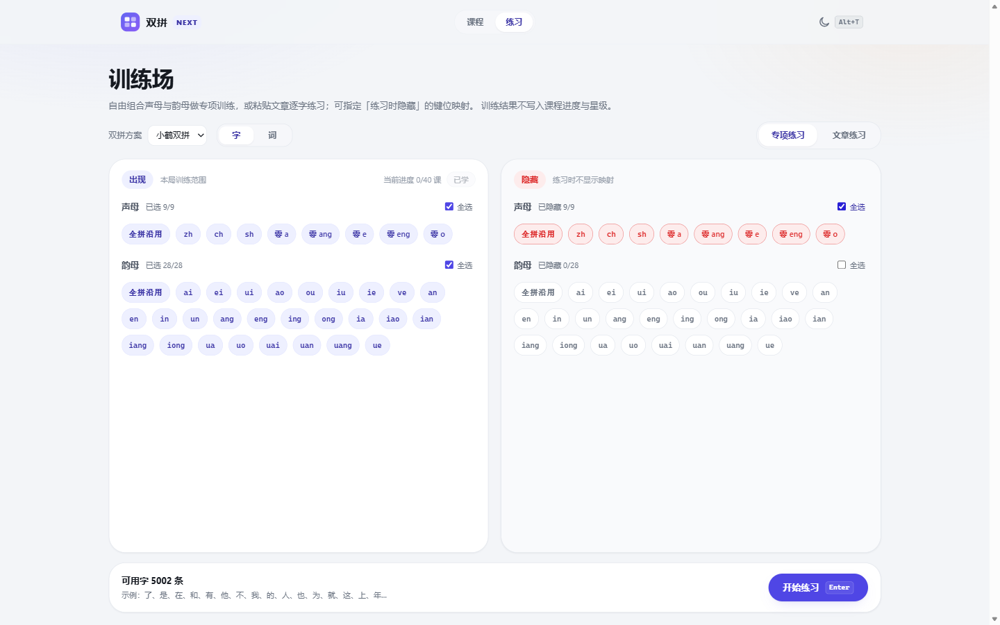

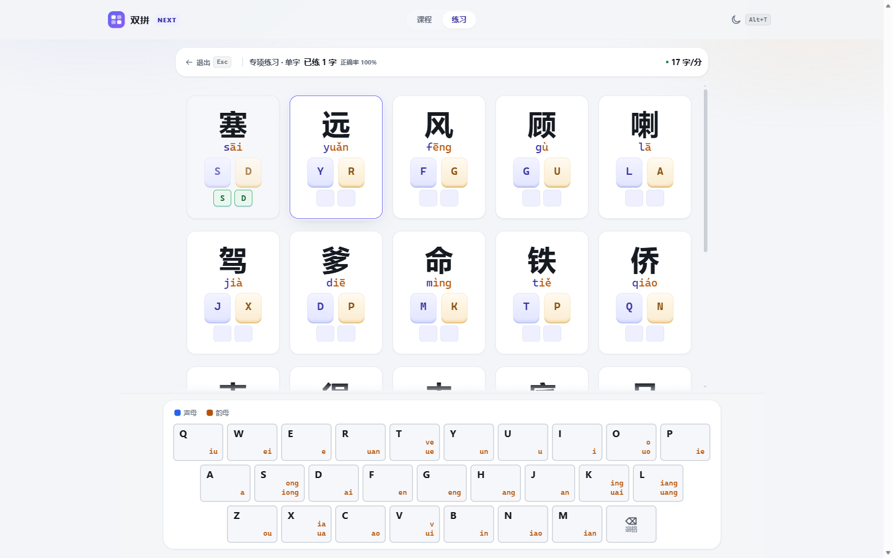

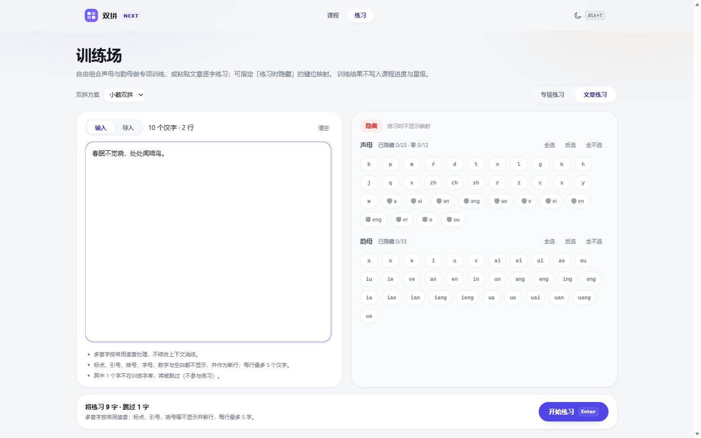

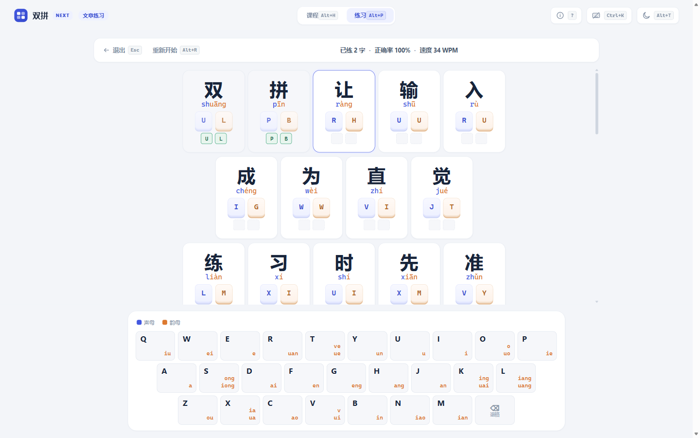

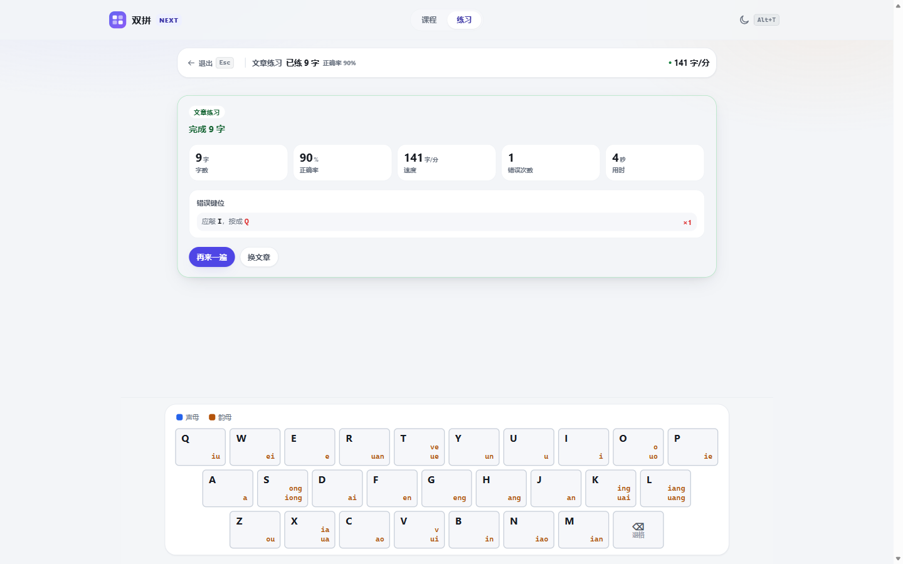

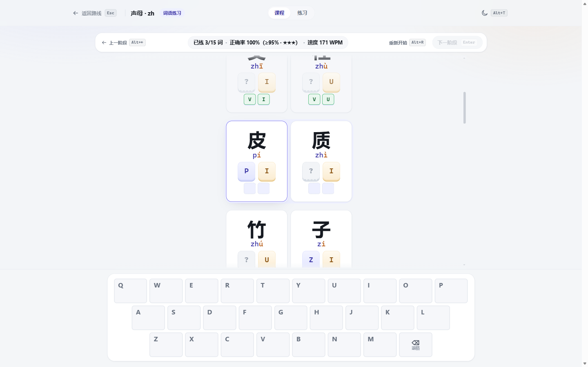


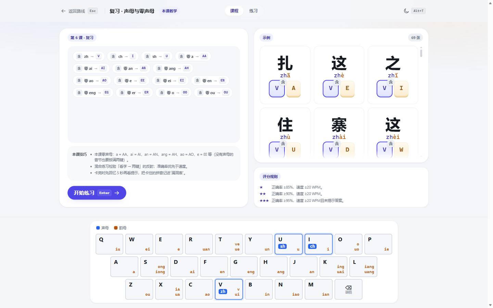


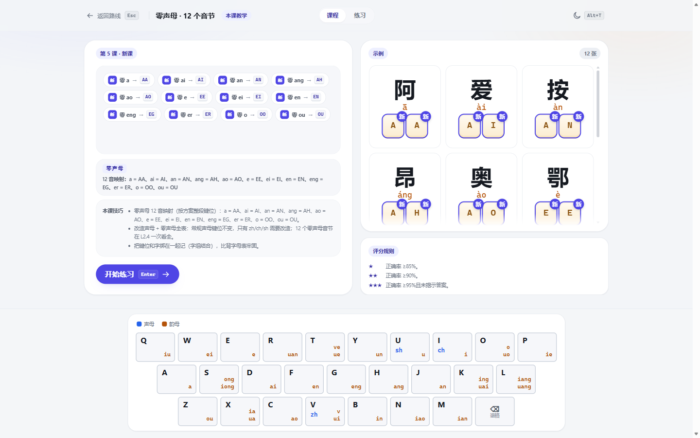

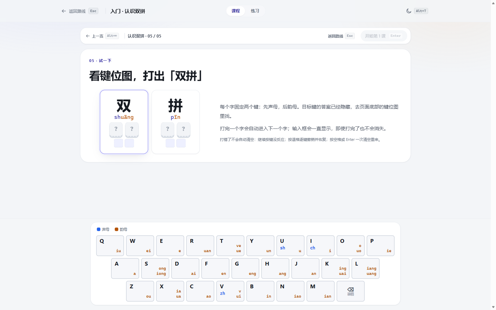

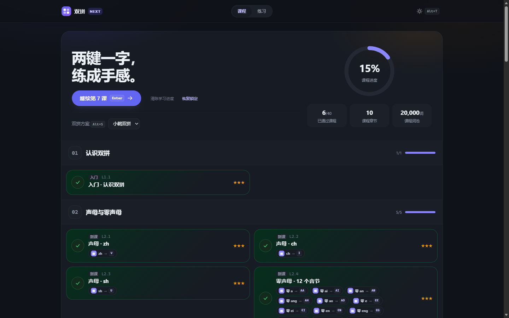

## 13. 边界与来源

- 参考项目：[BlueSky-07/Shuang](https://github.com/BlueSky-07/Shuang)（GPL-3.0）：仅键位映射作为事实来源，参考克隆不参与构建；`data/schemes/` 视为冻结数据（含 provenance 字段）；
- 词表/词频：[jieba](https://github.com/fxsjy/jieba)（MIT）；拼音转换：[pinyin-pro](https://github.com/zh-lx/pinyin-pro)（MIT，仅构建期）；
- 尚未实现：账号/云同步、SRS 复习、自定义方案编辑、数据可视化后台；发布前需完成许可评估。
