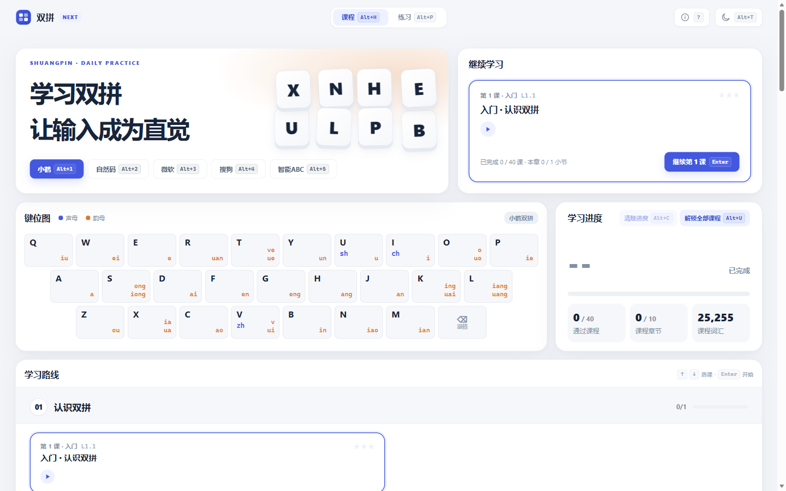
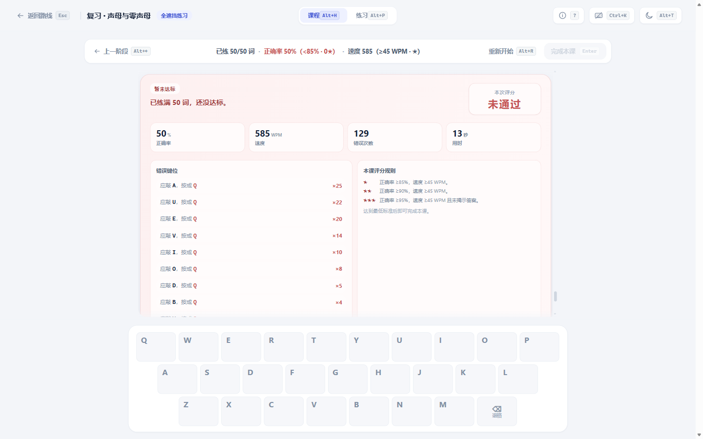
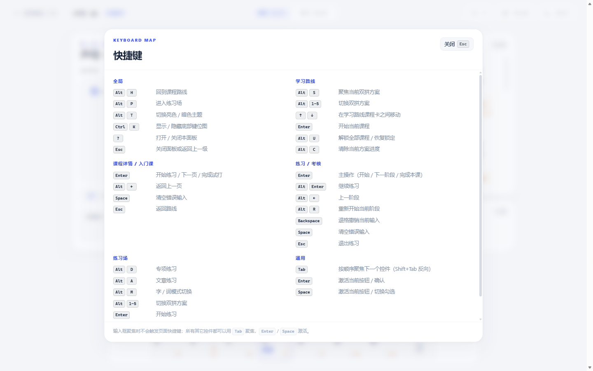

# 界面截图

[← 文档导航](../README.md#文档导航)

全部界面截图位于 `docs/assets/impl/`，由人工从实际运行的应用导出，**不随构建自动刷新**。截图用于文档展示，具体行为以应用与文字文档为准；本轮 UI 重构后部分细节（如键位图零声母行、练习场单行 Hero 键帽、动效）可能尚未反映到截图，更新 UI 后可重新导出。

## 学习路线

学习路线主界面：Hero、继续学习、键位图、学习进度与章节路线集中在一屏。

学习地图的 Hero 排版与两行键帽；方案行从两侧内容的较低处下方开始。

「解锁全部课程」后的状态：进度卡按钮变为「恢复锁定」。

零声母作为独立选择集的展示；标签统一为「零 x」前缀。

复习课的课程范围按学习顺序生成并展示，而不是按类型重排。

## 教学与练习

教学页：课程范围、键位讲解 / 记忆锚点、示例卡与评分标准。

课程详情右栏的评分标准，与判定同源，只展示 1–3 星。

练习会话顶栏的进度、正确率与实时速度。

全遮挡考核未达标时的阶段总结卡（红色），展示原因、错误键位与评分标准。

入门课完成试打后的状态，统一记录 ★★★。

课程练习中的词语半遮挡阶段与底部键位图的实时高亮。

## 练习场

练习场配置页的四卡布局与方案选择。

专项练习的会话：无尽批次、隐藏项提示与实时速度。

文章练习的输入卡：粘贴与 `.txt` 导入共用同一卡片。

文章逐字练习：非汉字断行，每行最多 5 个汉字。

文章练习完成汇总：字数、正确率、速度、错误次数与用时。

## 通用

`?` 打开的快捷键面板；数据源与页面绑定同源于 `lib/shortcuts.ts` 与各页 `useGlobalKeys`。

深色主题下的完成态；主题只覆盖 token，不改变布局。
